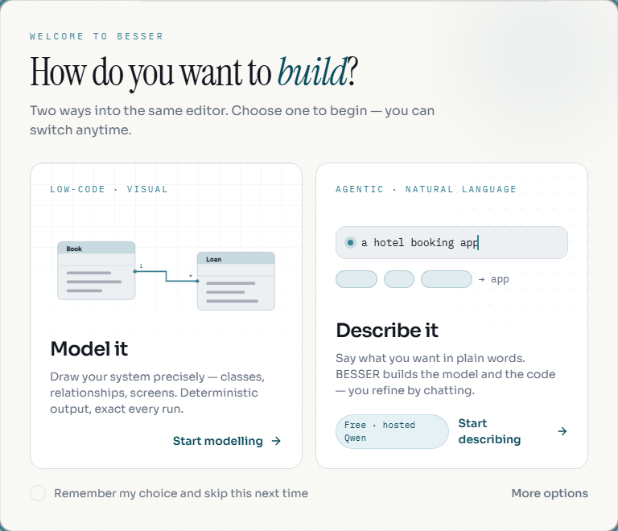
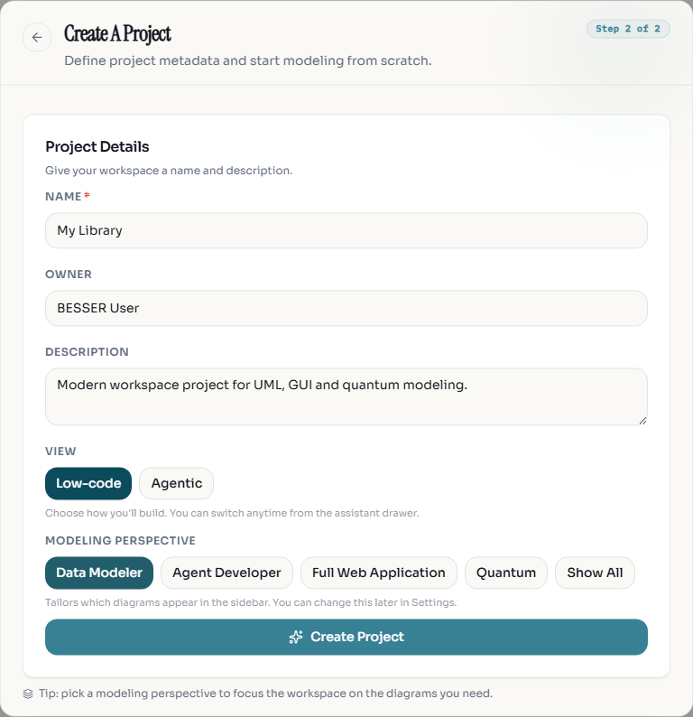
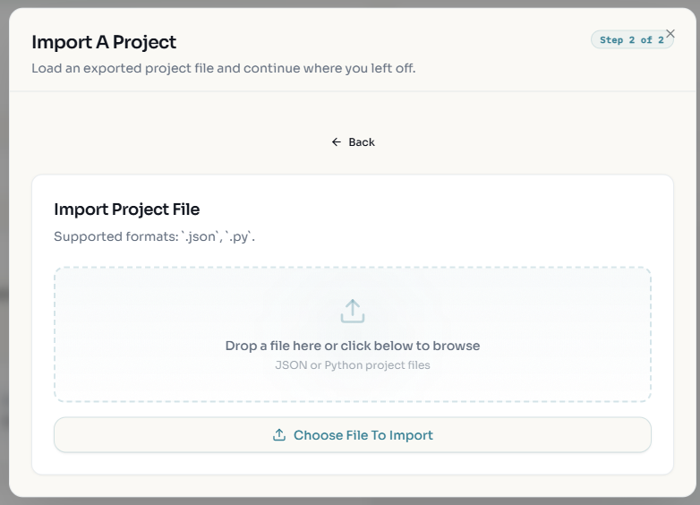
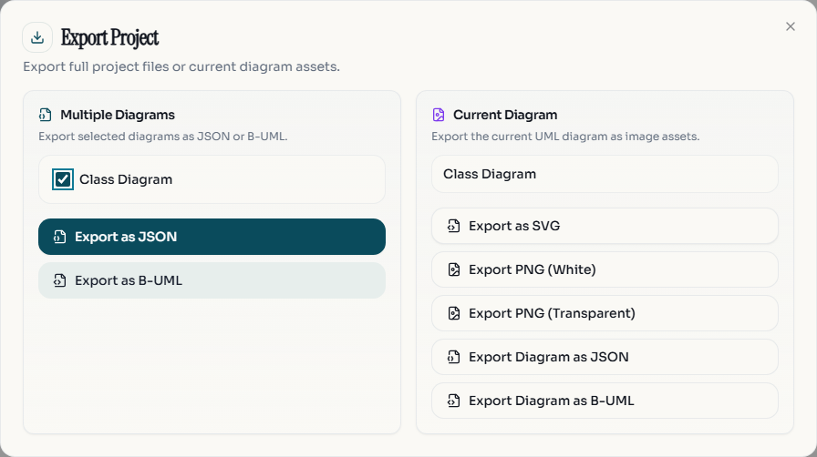
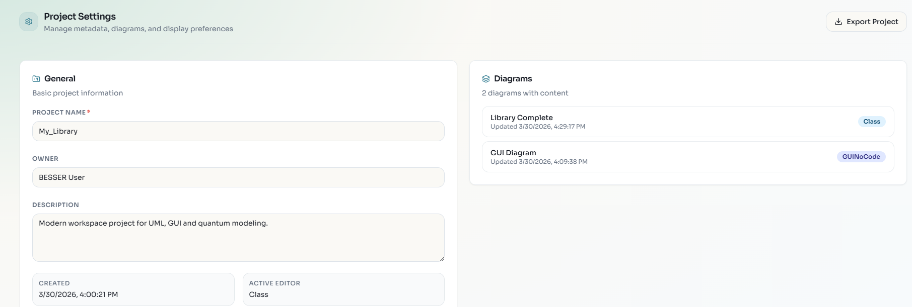

Project Management
==================

The Web Modeling Editor organizes your work into **Projects**. A project acts as a container for all your related diagrams, allowing you to manage complex systems effectively.

Projects live **in your browser** (``localStorage``, under keys prefixed
``besser_``). Nothing is stored on a BESSER server, so clearing site data
removes your projects — export or push to GitHub anything you want to keep.

The first thing you see
-----------------------

On a first visit the editor asks how you want to work:

   Choose the visual canvas or the assistant when starting a project.

* **Model it** — the low-code canvas: drag elements from the palette and edit
  them by hand.
* **Describe it** — the agentic workspace: the :doc:`AI assistant
  <ai-assistant>` opens next to the canvas and builds the model from your
  plain-language description.

Tick *Remember my choice* to skip the question next time (stored as
``besser_preferred_interface``). You can also force a mode with a URL
parameter: ``?agentic`` or ``?mode=agent`` opens the assistant workspace,
``?mode=model`` opens the low-code canvas. Either way the model is the same —
the choice only decides which surface opens first, and you can switch at any
time.

Choosing **More options** opens the project hub, which offers four ways to
start:

* **Create Blank** — an empty project with all editors available.
* **From Data** — build a class diagram from data, from one of two sources:

  * *Files (CSV, XLSX)*: upload one or more ``.csv``, ``.xlsx`` or ``.xls``
    files and the backend derives a class diagram from them.
  * *Statistics API (SDMX)*: pick a provider (Eurostat, the ECB, the OECD, the
    IMF, national statistics offices...) or enter the https URL of any SDMX 2.1
    API, then a dataflow id (``une_rt_m``, or ``AGENCY,ID,VERSION`` such as
    ``ECB,EXR,1.0``). The backend reads the dataflow's structure, its dimensions
    and codelists, and turns it into a class diagram: an ``Observation`` class,
    an enumeration per small codelist and a class per large or hierarchical one.
* **Import Project** — load an exported ``.json`` or a B-UML ``.py`` file.
* **Continue from GitHub** — reopen a repository BESSER generated earlier and
  keep building on it (see `Continuing from a GitHub repository`_).

Recently opened projects are listed underneath.

Creating a New Project
----------------------

1.  Click the **Home** icon 🏠 or select **File > New Project**.
2.  Choose **Low-code** for the visual canvas or **Agentic** for the assistant.
3.  Enter the project details:

    *   **Name**: A descriptive name for your project.
    *   **Description**: (Optional) A brief summary of the project's purpose.
    *   **Owner**: The name of the project owner.
    *   **Modeling Perspective**: Choose Data Modeler, Agent Developer,
        Multi-Agent, Full Web Application, Quantum, or Show All to select the
        diagrams visible in the sidebar. Multi-Agent shows the BPMN, Agent,
        Component, and Deployment diagrams and enables
        :ref:`agentic BPMN <agentic-bpmn>`. You can change this later in
        Settings.

4.  Click **Create Project**.

Importing Projects
------------------

You can import existing projects to continue your work or use templates.

1.  Click **File > Import Project**.
2.  Select the file to import. Supported formats are:
    *   **B-UML (.py)**: The standard Python-based format for BESSER models.
    *   **JSON (.json)**: The internal format used by the web editor.

Importing always creates a **new** project — it never overwrites the one you
have open.

Individual diagrams can also be imported into the current project from the
**File** menu; those accept ``.json``, ``.py``, ``.bpmn`` and ``.xml``, and are
added as a new tab rather than replacing an existing diagram. Two AI-assisted
importers convert external material into a class diagram:

*   **Import Class Diagram from Image** (``.png``, ``.jpg``) — reads a picture
    of a class diagram.
*   **Import Class Diagram from KG** (``.json``, ``.ttl``, ``.rdf``) — reads a
    knowledge graph.

Both of these write into the **active** class diagram.

Diagram tabs
------------

Each diagram type has its own tab strip above the canvas, showing only the
diagrams of the type currently selected in the left sidebar.

*   **Add**: the ``+`` button creates another diagram of the active type. A
    project holds at most **five diagrams per type**; the button disappears at
    the cap.
*   **Rename**: double-click a tab, type, then Enter (Escape cancels).
*   **Delete**: the ``×`` on the tab. The last remaining diagram of a type
    cannot be closed.

Object and GUI No-Code diagrams additionally show a **Linked Diagrams** row
where you pick the class diagram they draw their types from; object diagrams get
a wand button that scaffolds objects from that class diagram. User diagrams show
a validation dot and an **Edit as Form** toggle that swaps the canvas for a
guided form.

Exporting Projects
------------------

To save your work or use it with other BESSER tools:

   Use **Export as JSON** on the left for a project backup; image exports
   on the right save only the current diagram.

1.  Click **File > Export Project**.
2.  The dialog has two halves.

**Multiple diagrams** — tick the diagram types to include, then:

*   **Export as JSON**: the whole project as ``<Project_Name>.json``. This is
    the file the import flow reads back.
*   **Export as B-UML**: the whole project as a single ``<project>_besser.py``.

**Current diagram** — requires a UML diagram to be open:

*   **Export as SVG**
*   **Export PNG (White)** / **Export PNG (Transparent)**
*   **Export Diagram as JSON**
*   **Export Diagram as B-UML** (the model is validated first)

Project Settings
----------------

You can modify project metadata at any time.

1.  Click the **Settings** icon ⚙️ in the sidebar.
2.  Update the Name, Description, or Owner.
3.  View the unique **Project ID**.

The settings page also holds:

*   **Display** — show instanced objects, show association names, properties
    panel, and the class-diagram notation switch (**UML** or **ER**; this
    changes rendering only, not the model).
*   **AI / LLM API Key** — see :doc:`ai-keys`.
*   **Diagrams** — which diagrams currently hold content, and when each changed.
*   **Modeling Perspectives** — which diagram types appear in the sidebar (see
    :doc:`diagrams/index`).

Language and theme are not here: the language selector and the light/dark toggle
live in the top bar.

GitHub Integration
------------------

The editor supports syncing projects with GitHub repositories, allowing version control
and collaboration on your models.

Connecting to GitHub
~~~~~~~~~~~~~~~~~~~~

1. Click the **GitHub** account button in the top bar (or **Sync** to open the
   GitHub panel on the right).
2. You are redirected to GitHub to authorise the BESSER OAuth app, and sent back
   to the editor signed in. A toast confirms *Signed in as …*.

The editor never sees your GitHub access token: the BESSER backend performs the
OAuth exchange, keeps the token server-side, and hands the browser only an
opaque session id. That session id is held in this browser tab
(``sessionStorage``) and expires after **24 hours**; your username is kept in
``localStorage`` for convenience. Sign out from the account dropdown in the top
bar.

One repository per project
~~~~~~~~~~~~~~~~~~~~~~~~~~

A project is linked to **one** repository. The GitHub panel, the Spec-Driven
Agent's *Push to GitHub* and *Continue from GitHub* all use that same link, and
the link is also written into the repository, so any browser that opens the repo
finds its project again. Every repository BESSER writes has the same layout:

- ``buml/diagrams.json``: the model, the only file the editor reads back.
- ``buml/*.py``: the same model as B-UML Python source, for reading without the
  editor.
- ``.besser/project.json``: which BESSER project the repository belongs to.
- the app code, when the Spec-Driven Agent built one.

BESSER also tags the repository with the ``besser`` topic, which is how the
repository browser lists your BESSER projects first. Older repositories that
hold a ``besser-project.json`` still open; the first save moves the model to
``buml/diagrams.json`` and removes the old file in the same commit.

Linking a repository
~~~~~~~~~~~~~~~~~~~~

Open the GitHub panel (the branch button in the top bar). For a project without
a repository you can:

- **Create a repository**: name it and choose private or public. The first
  commit holds the model and a README.
- **Link an existing repository**: the browser lists your BESSER projects first
  (search reaches every repository). Selecting one shows its model, its
  diagrams and classes, and its last commit with who made it. If it already
  holds a model you choose between loading that model and keeping yours.

Staying in sync
~~~~~~~~~~~~~~~

The top bar shows the linked repository and a dot for its state: in sync,
model changes not saved yet, new commits on GitHub, or both. The editor checks
the repository when you return to the tab and once a minute.

- **Save to GitHub** commits the model. If someone pushed since your last sync,
  BESSER merges their commits with yours instead of overwriting them, and the
  editor then shows the merged model. When GitHub cannot merge the two on its own
  (both changed the same part of the model), your save goes to a ``besser/sync-…``
  branch and the panel offers a pull request. Nothing is overwritten.
- **Pull the latest version** loads the repository's model, and its code as the
  starting point of the next Spec-Driven Agent run. It asks first when you have
  unsaved model changes.
- **Update the app code** asks the Spec-Driven Agent to bring the repository's
  app in line with your model. You review the run, then push it.

Going live
~~~~~~~~~~

For a project linked to a repository, **Deploy > Go live from GitHub** (or
**Go live** in the GitHub panel) puts the app that is in the repository online
on Render. What goes live is exactly the repository's code, so the app the
Spec-Driven Agent built, with every change it made, is the app people use.

1. BESSER adds Render's deploy file to the repository, written for the app's
   real folders, and commits nothing else.
2. You open Render, sign in with GitHub and click **Apply**, once. A private
   repository needs Render to be given access to it first.
3. From then on every code save to GitHub updates the live app, and saving only
   the model does not.

Go live supports apps with a FastAPI backend and an optional React (Vite)
frontend. For anything else it says why and offers the classic deploy, which
rebuilds the app from the diagrams into a separate repository. Render's free
plan puts an idle app to sleep, and its database resets on each redeploy.

Model history
~~~~~~~~~~~~~

The panel lists recent commits that changed the model. Each one says who made
it (the Spec-Driven Agent, the editor, or a person on GitHub), when, and what
it changed in the class diagram, for example ``class Loan added``. Restore any
earlier version into the editor; it then counts as an unsaved change.

Auto-commit
~~~~~~~~~~~

Under **Settings** in the GitHub panel you can switch on auto-commit and pick an
interval (5, 10, 15, 30 or 60 minutes). It is off by default, needs a linked
repository, and skips ticks where nothing changed.

Sharing as a gist
~~~~~~~~~~~~~~~~~

**Share ▸ Create secret gist** publishes the project JSON as a GitHub gist —
secret by default — and opens it in a new tab.

Continuing from a GitHub repository
~~~~~~~~~~~~~~~~~~~~~~~~~~~~~~~~~~~

A repository that BESSER itself generated can be reopened from the project hub's
**Continue from GitHub** card, which uses the same repository browser. This
imports the stored model as a new project and links the repo at the imported
commit, so the :doc:`Spec-Driven Agent <spec-driven-agent>` can keep editing the
application it built earlier. If a project in this browser is already linked to
that repository, the hub pulls into that project instead of making a copy.
